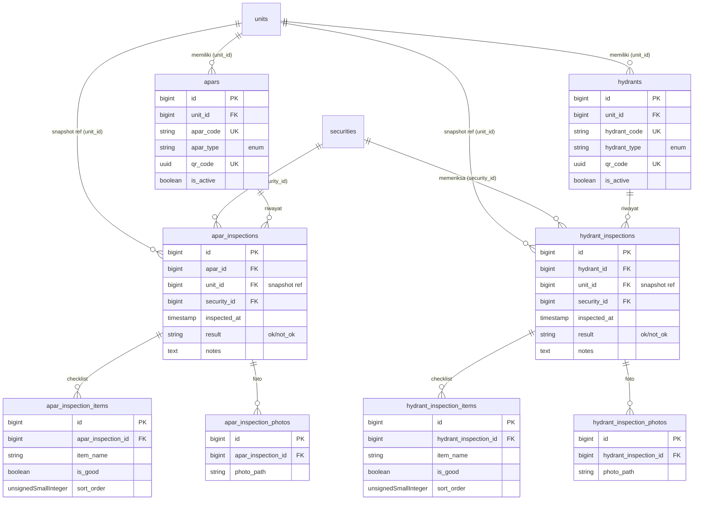

# DATABASE_SCHEMA — Modul Asset (APAR & Hydrant)

> **Status:** ASSET-03C — 8 migration terimplementasi dan terverifikasi secara teknis. Dokumen ini mencerminkan struktur aktual migration/model. Struktur Hydrant tetap memakai `hydrant_code` dan `hydrant_type`. File SQL APAR asli belum tersedia, sehingga kompatibilitas import data APAR belum dapat diverifikasi (B-01).
>
> **Acuan:** `BUSINESS_RULES.md`, `ARCHITECTURE.md`, pola migration existing (`units`, `securities`, `patrol_points`, dll.), kompatibilitas MySQL 8.4 & SQLite (testing).
>
> **Catatan penting:** ASSET-03 (verifikasi 8 migration acuan pemilik) tetap tercatat **BLOCKED (B-01)** di roadmap karena file acuan belum tersedia di repo. Dokumen ini adalah **spesifikasi final internal** agar implementasi migration dapat disiapkan secara konsisten; saat migration acuan pemilik tersedia, lakukan penyesuaian/verifikasi terhadap acuan tersebut (terutama penamaan/definisi `is_good` dan FK) tanpa mengubah aturan bisnis.

## 1. Ringkasan Tabel
| # | Tabel | Jenis | Keterangan |
|---|---|---|---|
| 1 | `apars` | Master | Data APAR, milik `unit_id`, QR UUID unik |
| 2 | `apar_inspections` | Histori (header) | Record inspeksi baru (immutable), snapshot aset+unit, inspector `security_id` |
| 3 | `apar_inspection_items` | Histori (detail) | Checklist item + `is_good`, bagian dari record inspeksi |
| 4 | `apar_inspection_photos` | Histori (lampiran) | Foto inspeksi (maks 5 via validasi aplikasi) |
| 5 | `hydrants` | Master | Data Hydrant, milik `unit_id`, QR UUID unik |
| 6 | `hydrant_inspections` | Histori (header) | Record inspeksi baru (immutable), snapshot aset+unit, inspector `security_id` |
| 7 | `hydrant_inspection_items` | Histori (detail) | Checklist item + `is_good`, bagian dari record inspeksi |
| 8 | `hydrant_inspection_photos` | Histori (lampiran) | Foto inspeksi (maks 5 via validasi aplikasi) |

**Tanpa relasi ke:** `schedules`, `shifts`, `attendance*`, `patrol_sessions`, `patrol_points` (dan tabel patrol/attendance/scheduling lain). **Tanpa master/reference table tambahan** untuk MVP.

## 2. ERD (Mermaid)

## 3. Spesifikasi Tabel

Konvensi umum: `id` = unsigned big integer PK auto-increment; `timestamps()` = `created_at`/`updated_at` nullable (Laravel default) kecuali disebut lain. Semua FK memakai tipe unsigned big integer (`foreignId`/`constrained`). **Aturan delete histori/master:** `restrictOnDelete` pada seluruh relasi aset↔inspeksi, unit/security→master/inspeksi, dan inspeksi→items/photos untuk melindungi histori (tidak ada cascade delete pada aset/histori). Penghapusan histori tidak didukung oleh desain/aplikasi.

### 3.1 `apars` (master APAR)
| Kolom | Tipe | Nullable | Default | Enum/Aturan | Keterangan |
|---|---|---|---|---|---|
| `id` | bigIncrements | NO | - | PK | |
| `unit_id` | foreignId (bigint unsigned) | NO | - | FK → `units.id`, **restrictOnDelete** | Pemilik aset; hierarki via Unit existing |
| `apar_code` | string(50) | NO | - | **unique** | Kode unik APAR |
| `apar_type` | string/enum | NO | - | enum: `dry_chemical`,`co2`,`foam`,`air`,`powder` | Jenis APAR |
| `brand` | string(100) | NO | - | - | Merek |
| `capacity` | string(50) | NO | - | - | Kapasitas (string agar fleksibel, mis. "6 Kg") |
| `serial_number` | string(100) | YES | null | - | Nomor seri |
| `procurement_date` | date | YES | null | - | Tanggal pengadaan |
| `installation_date` | date | YES | null | - | Tanggal pemasangan |
| `recharge_date` | date | YES | null | - | Tanggal isi ulang |
| `expiry_date` | date | YES | null | - | Masa berlaku APAR (master) |
| `placement` | string(255) | NO | - | - | Lokasi/penempatan |
| `qr_code` | uuid (char(36)) | NO | - | **unique** | Identitas QR APAR |
| `is_active` | boolean | NO | `true` | - | Aset non-aktif tidak boleh diinspeksi |
| `photo` | string(255) | YES | null | - | Path foto master (opsional) |
| `created_at`, `updated_at` | timestamps | YES | - | - | |

**Index/Unique:** unique `apar_code`, unique `qr_code`; index `unit_id`, index `is_active`, index `apar_type`, index `expiry_date` (pencarian/filter). **FK:** `unit_id` → `units.id` **ON DELETE RESTRICT** ON UPDATE RESTRICT (default).

### 3.2 `apar_inspections` (header inspeksi, immutable)
| Kolom | Tipe | Nullable | Default | Enum/Aturan | Keterangan |
|---|---|---|---|---|---|
| `id` | bigIncrements | NO | - | PK | |
| `apar_id` | foreignId | NO | - | FK → `apars.id`, **restrictOnDelete** | Referensi aset (histori terlindungi) |
| `unit_id` | foreignId | NO | - | FK → `units.id`, **restrictOnDelete** | Pemilik/scope saat inspeksi (snapshot ref) |
| `security_id` | foreignId | NO | - | FK → `securities.id`, **restrictOnDelete** | Pemeriksa |
| `inspected_at` | timestamp | NO | - | **waktu server** saat simpan | Waktu inspeksi (sumber kebenaran server) |
| `result` | string(20) / enum | NO | - | enum: `ok`,`not_ok` | `ok` jika semua `is_good=true`, else `not_ok` |
| `notes` | text | YES | null | **wajib (app) jika `not_ok`** | Catatan inspeksi |
| `unit_name_snapshot` | string(255) | NO | - | - | Snapshot nama unit |
| `unit_code_snapshot` | string(50) | YES | null | - | Snapshot kode unit |
| `apar_code_snapshot` | string(50) | NO | - | - | Snapshot kode APAR |
| `apar_type_snapshot` | string(30) | NO | - | - | Snapshot jenis |
| `brand_snapshot` | string(100) | YES | null | - | Snapshot merek |
| `capacity_snapshot` | string(50) | YES | null | - | Snapshot kapasitas |
| `serial_number_snapshot` | string(100) | YES | null | - | Snapshot serial |
| `placement_snapshot` | string(255) | YES | null | - | Snapshot penempatan |
| `apar_expiry_date_snapshot` | date | YES | null | - | Snapshot masa berlaku master saat inspeksi |
| `created_at`, `updated_at` | timestamps | YES | - | - | `created_at` merekam waktu simpan record |

**Index/Unique:** index (`apar_id`,`inspected_at`), index `unit_id`, index `security_id`, index `result`, index `inspected_at`. **FK:** `apar_id`→`apars` restrict, `unit_id`→`units` restrict, `security_id`→`securities` restrict. **Immutability:** tidak ada update/delete record oleh alur aplikasi; DB mencegah penghapusan berantai aset/unit/inspector.

### 3.3 `apar_inspection_items` (detail checklist, immutable)
| Kolom | Tipe | Nullable | Default | Enum/Aturan | Keterangan |
|---|---|---|---|---|---|
| `id` | bigIncrements | NO | - | PK | |
| `apar_inspection_id` | foreignId | NO | - | FK → `apar_inspections.id`, **cascadeOnDelete** | Header inspeksi (FK cascade hanya dari inspeksi induk; header histori dilindungi) |
| `item_name` | string(50) | NO | - | key checklist (lihat daftar) | Kunci item |
| `item_label` | string(150) | NO | - | - | Label tampilan |
| `is_good` | boolean | NO | - | - | Hasil item (sesuai acuan; definisi final mengikuti migration acuan saat verifikasi) |
| `note` | text | YES | null | - | Catatan per item |
| `sort_order` | unsignedSmallInteger | NO | 0 | - | Urutan tampil |
| `created_at`, `updated_at` | timestamps | YES | - | - | |

**Index/Unique:** index `apar_inspection_id`; unique (`apar_inspection_id`,`item_name`) untuk konsistensi 1 baris per item per inspeksi. **FK:** `apar_inspection_id`→`apar_inspections` **cascadeOnDelete** (hanya dari inspeksi induk).

**Checklist APAR (10 item):**
| sort_order | item_name | item_label |
|---|---|---|
| 1 | `pressure_gauge` | Indikator Tekanan |
| 2 | `operating_lever` | Tuas Pengoperasian |
| 3 | `safety_pin_seal` | Pin Pengaman & Segel |
| 4 | `nozzle` | Corong Semprot |
| 5 | `hose` | Selang |
| 6 | `discharge_orifice` | Lubang Keluar |
| 7 | `carrying_handle` | Pegangan |
| 8 | `body` | Badan Tabung |
| 9 | `label` | Label & Penulisan |
| 10 | `expiry_date` | Masa Berlaku |

### 3.4 `apar_inspection_photos` (lampiran foto, immutable)
| Kolom | Tipe | Nullable | Default | Enum/Aturan | Keterangan |
|---|---|---|---|---|---|
| `id` | bigIncrements | NO | - | PK | |
| `apar_inspection_id` | foreignId | NO | - | FK → `apar_inspections.id`, **cascadeOnDelete** | Header inspeksi (FK cascade hanya dari inspeksi induk; header histori dilindungi) |
| `photo_path` | string(255) | NO | - | - | Path file (storage privat, stream terotorisasi) |
| `caption` | string(255) | YES | null | - | Keterangan foto |
| `created_at`, `updated_at` | timestamps | YES | - | - | |

**Index/Unique:** index `apar_inspection_id`. **FK:** `apar_inspection_id`→`apar_inspections` **cascadeOnDelete** (hanya dari inspeksi induk). **Aturan aplikasi:** maksimal **5 foto** per inspeksi.

### 3.5 `hydrants` (master Hydrant)
| Kolom | Tipe | Nullable | Default | Enum/Aturan | Keterangan |
|---|---|---|---|---|---|
| `id` | bigIncrements | NO | - | PK | |
| `unit_id` | foreignId | NO | - | FK → `units.id`, **restrictOnDelete** | Pemilik aset |
| `hydrant_code` | string(50) | NO | - | **unique** | Kode unik Hydrant |
| `name` | string(150) | NO | - | - | Nama aset/identitas |
| `hydrant_type` | string/enum | NO | - | enum: `fire_pump_diesel`,`fire_pump_electric`,`jockey_pump`,`hydrant_box`,`hydrant_pillar`,`siamese_connection` | MVP: `fire_pump_diesel` (lain tersedia) |
| `brand` | string(100) | NO | - | - | Merek |
| `model` | string(100) | NO | - | - | Model |
| `serial_number` | string(100) | YES | null | - | Nomor seri |
| `procurement_date` | date | YES | null | - | Tanggal pengadaan |
| `installation_date` | date | YES | null | - | Tanggal pemasangan |
| `last_maintenance_date` | date | YES | null | - | Perawatan terakhir |
| `placement` | string(255) | NO | - | - | Lokasi/penempatan |
| `qr_code` | uuid (char(36)) | NO | - | **unique** | Identitas QR Hydrant |
| `photo` | string(255) | YES | null | - | Path foto master (opsional) |
| `is_active` | boolean | NO | `true` | - | Aset non-aktif tidak boleh diinspeksi |
| `created_at`, `updated_at` | timestamps | YES | - | - | |

**Index/Unique:** unique `hydrant_code`, unique `qr_code`; index `unit_id`, index `is_active`, index `hydrant_type`. **FK:** `unit_id`→`units` **restrictOnDelete**.

### 3.6 `hydrant_inspections` (header inspeksi, immutable)
| Kolom | Tipe | Nullable | Default | Enum/Aturan | Keterangan |
|---|---|---|---|---|---|
| `id` | bigIncrements | NO | - | PK | |
| `hydrant_id` | foreignId | NO | - | FK → `hydrants.id`, **restrictOnDelete** | Referensi aset |
| `unit_id` | foreignId | NO | - | FK → `units.id`, **restrictOnDelete** | Snapshot ref pemilik/scope |
| `security_id` | foreignId | NO | - | FK → `securities.id`, **restrictOnDelete** | Pemeriksa |
| `inspected_at` | timestamp | NO | - | **waktu server** saat simpan | Waktu inspeksi |
| `result` | string(20) / enum | NO | - | enum: `ok`,`not_ok` | Hasil agregat checklist |
| `notes` | text | YES | null | **wajib (app) jika `not_ok`** | Catatan |
| `unit_name_snapshot` | string(255) | NO | - | - | Snapshot nama unit |
| `unit_code_snapshot` | string(50) | YES | null | - | Snapshot kode unit |
| `hydrant_code_snapshot` | string(50) | NO | - | - | Snapshot kode Hydrant |
| `name_snapshot` | string(150) | YES | null | - | Snapshot nama |
| `hydrant_type_snapshot` | string(30) | NO | - | - | Snapshot jenis |
| `brand_snapshot` | string(100) | YES | null | - | Snapshot merek |
| `model_snapshot` | string(100) | YES | null | - | Snapshot model |
| `serial_number_snapshot` | string(100) | YES | null | - | Snapshot serial |
| `placement_snapshot` | string(255) | YES | null | - | Snapshot penempatan |
| `last_maintenance_date_snapshot` | date | YES | null | - | Snapshot perawatan terakhir |
| `created_at`, `updated_at` | timestamps | YES | - | - | |

**Index/Unique:** index (`hydrant_id`,`inspected_at`), index `unit_id`, index `security_id`, index `result`, index `inspected_at`. **FK:** semua restrictOnDelete.

### 3.7 `hydrant_inspection_items` (detail checklist, immutable)
| Kolom | Tipe | Nullable | Default | Enum/Aturan | Keterangan |
|---|---|---|---|---|---|
| `id` | bigIncrements | NO | - | PK | |
| `hydrant_inspection_id` | foreignId | NO | - | FK → `hydrant_inspections.id`, **cascadeOnDelete** | Header inspeksi (FK cascade hanya dari inspeksi induk; header histori dilindungi) |
| `item_name` | string(50) | NO | - | key checklist | Kunci item |
| `item_label` | string(150) | NO | - | - | Label tampilan |
| `is_good` | boolean | NO | - | - | Hasil item |
| `note` | text | YES | null | - | Catatan per item |
| `sort_order` | unsignedSmallInteger | NO | 0 | - | Urutan tampil |
| `created_at`, `updated_at` | timestamps | YES | - | - | |

**Index/Unique:** index `hydrant_inspection_id`; unique (`hydrant_inspection_id`,`item_name`). **FK:** `hydrant_inspection_id`→`hydrant_inspections` **cascadeOnDelete** (hanya dari inspeksi induk).

**Checklist Hydrant (11 item):**
| sort_order | item_name | item_label |
|---|---|---|
| 1 | `kondisi_baterai` | Kondisi Baterai |
| 2 | `kondisi_pelumas` | Kondisi Pelumas |
| 3 | `kondisi_air_radiator` | Kondisi Air Radiator |
| 4 | `kondisi_bahan_bakar` | Kondisi Minyak / Bahan Bakar |
| 5 | `pemanasan` | Pemanasan |
| 6 | `kondisi_mesin` | Kondisi Mesin |
| 7 | `pressure_gauge` | Pressure Gauge |
| 8 | `kebocoran` | Kebocoran |
| 9 | `panel_indikator` | Panel / Indikator |
| 10 | `valve` | Valve |
| 11 | `pipa_sambungan` | Pipa dan Sambungan |

### 3.8 `hydrant_inspection_photos` (lampiran foto, immutable)
| Kolom | Tipe | Nullable | Default | Enum/Aturan | Keterangan |
|---|---|---|---|---|---|
| `id` | bigIncrements | NO | - | PK | |
| `hydrant_inspection_id` | foreignId | NO | - | FK → `hydrant_inspections.id`, **cascadeOnDelete** | Header inspeksi (FK cascade hanya dari inspeksi induk; header histori dilindungi) |
| `photo_path` | string(255) | NO | - | - | Path file (storage privat) |
| `caption` | string(255) | YES | null | - | Keterangan foto |
| `created_at`, `updated_at` | timestamps | YES | - | - | |

**Index/Unique:** index `hydrant_inspection_id`. **FK:** `hydrant_inspection_id`→`hydrant_inspections` **cascadeOnDelete** (hanya dari inspeksi induk). **Aturan aplikasi:** maksimal **5 foto** per inspeksi.

## 4. Strategi Snapshot, FK, Index, Unique, dan Perlindungan Histori

### 4.1 Snapshot (konsistensi histori)
- **Waktu pengambilan:** saat inspeksi disimpan (server-side, dalam transaksi yang sama dengan pembuatan header+items+photos). Nilai disalin dari master aset dan unit terkait pada saat itu.
- **Unit snapshot:** `unit_id` (FK ref, restrict) + `unit_name_snapshot`, `unit_code_snapshot` pada header inspeksi agar tampilan histori tetap benar meski data unit berubah (dan unit tidak dapat dihapus selama direferensikan).
- **Aset snapshot:** kolom `*_snapshot` pada header (kode, jenis/nama, merek/model, kapasitas/placement/serial/tanggal relevan) menyalin atribut kunci master. Riwayat tetap bermakna meski master aset diperbarui/dinonaktifkan.
- **Inspector:** `security_id` disimpan pada header; identitas tampil dapat di-resolve saat ini, relasi di-restrict untuk melindungi histori.

### 4.2 Foreign Key & aturan delete (perlindungan histori)
- **Master aset (`apars`,`hydrants`):** `unit_id` → `units` **RESTRICT**. Aset tidak boleh ikut terhapus oleh unit; penghapusan aset fisik dengan histori dicegah (DB restrict karena inspeksi mereferensikan aset).
- **Header inspeksi:** `apar_id`/`hydrant_id` → master **RESTRICT**; `unit_id` → `units` **RESTRICT**; `security_id` → `securities` **RESTRICT**. Mencegah hilangnya konteks histori.
- **Items & photos:** `*_inspection_id` → header inspeksi **CASCADE ON DELETE** (hanya dari inspeksi induknya) sesuai spesifikasi; header inspeksi sendiri dilindungi (FK aset/unit/security = **RESTRICT**) dan tidak dihapus/diubah oleh aplikasi (histori immutable, record baru).
- **Tidak ada operasi destruktif histori:** aplikasi tidak menyediakan update/delete record inspeksi/item/foto; setiap submit = record baru.

### 4.3 Index
- **Master:** index `unit_id` (scope/list per unit), `is_active` (filter aset aktif), `apar_type`/`hydrant_type`; unique `apar_code`/`hydrant_code`, unique `qr_code`.
- **Header inspeksi:** komposit (`asset_id`,`inspected_at`) untuk riwayat per aset urut waktu, index `unit_id`, `security_id`, `result`, `inspected_at` (pelaporan/filter).
- **Detail:** index FK `*_inspection_id`; unique (`*_inspection_id`,`item_name`) pada items.

### 4.4 Unique constraint
- `apars.apar_code`, `apars.qr_code`, `hydrants.hydrant_code`, `hydrants.qr_code` (global unique).
- (`apar_inspection_items.apar_inspection_id`,`item_name`) dan (`hydrant_inspection_items.hydrant_inspection_id`,`item_name`) untuk integritas checklist per inspeksi.

### 4.5 Integritas & aturan aplikasi (terkait DB)
- `inspected_at` diisi waktu **server** saat simpan.
- `result`: `ok` jika seluruh item `is_good=true`; `not_ok` jika minimal satu `false`. `notes` **wajib** jika `not_ok` (validasi aplikasi; kolom nullable di DB).
- Maks **5 foto** per inspeksi (validasi aplikasi; tabel terpisah mendukung 0..5 baris).
- Aset `is_active=false` **tidak boleh diinspeksi** (validasi aplikasi); histori tetap dapat dilihat.
- `qr_code` diisi UUID unik saat pembuatan aset.

## 5. Keputusan Teknis Penting (ringkas)
1. **Snapshot eksplisit di header inspeksi** (kolom terpisah unit+atribut kunci aset) dipilih agar mudah dibaca/query dan aman lintas MySQL/SQLite tanpa bergantung semantik JSON kompleks.
2. **Perlindungan histori:** FK `apars/hydrants.unit_id` dan header inspeksi (`*_id`, `unit_id`, `security_id`) = **RESTRICT** untuk mencegah penghapusan aset/unit/security yang memiliki histori. **Items/photos → header inspeksi = CASCADE ON DELETE** (hanya dari inspeksi induknya) sesuai spesifikasi; karena header tidak dihapus/diubah oleh aplikasi dan aset/unit/security direstrict, histori tetap terlindungi.
3. **`result` disimpan sebagai enum/string (`ok`,`not_ok`)** hasil agregasi server-side; `notes` nullable di DB, wajib oleh validasi saat `not_ok`.
4. **`apar_type`/`hydrant_type` sebagai enum DB** (konsisten dengan pola proyek seperti `units.unit_level`); `hydrant_type` mencakup 6 nilai (MVP operasional: `fire_pump_diesel`).
5. **`is_good` boolean** pada items; **penamaan/definisi final tetap harus diverifikasi** terhadap migration acuan pemilik saat tersedia (B-01/ASSET-03).
6. **Unique code & QR global** (`*_code`, `qr_code`) untuk identifikasi/QR; indeks waktu (`asset_id`,`inspected_at`) untuk riwayat.
7. **Kompatibilitas MySQL 8.4 & SQLite:** gunakan tipe umum Laravel (`id/foreignId`, `string`, `text`, `date`, `timestamp`, `boolean`, `unsignedSmallInteger`, `uuid/char(36)`), hindari fitur spesifik-engine; enum/boolean/uuid didukung oleh schema builder pada kedua target (perlu diverifikasi saat test migrate di ASSET-03C/testing).
8. **Tidak ada master/reference table checklist tambahan** (MVP): `item_name/item_label/sort_order` disimpan per record inspeksi dari definisi checklist tetap di aplikasi.

## 6. Rencana Urutan Implementasi Migration (ASSET-03C, referensi)
Urutan (setelah `2026_11_15_000011`, suffix berurutan unik, contoh `2026_11_16_000001`–`000008`), mengikuti ketergantungan FK:
1. `apars`
2. `hydrants`
3. `apar_inspections`
4. `hydrant_inspections`
5. `apar_inspection_items`
6. `apar_inspection_photos`
7. `hydrant_inspection_items`
8. `hydrant_inspection_photos`

*(Final nama/timestamp/susunan wajib diselaraskan dengan migration acuan pemilik jika/ketika tersedia.)*

## 7. Catatan Import SQL APAR
- Struktur aktual APAR memakai `apar_code` dan `apar_type`.
- Struktur aktual Hydrant memakai `hydrant_code` dan `hydrant_type`; rename ke `code`/`type` belum dilakukan.
- File SQL APAR belum tersedia di repository, sehingga kompatibilitas tipe data, constraint, dan data import belum dapat diverifikasi (B-01).
