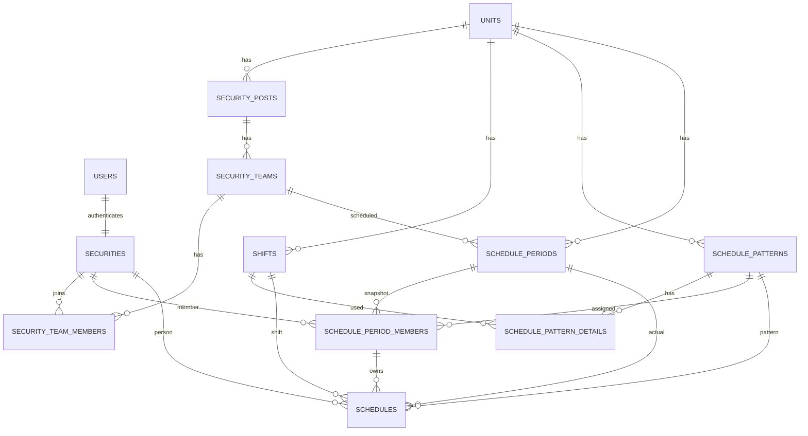

# Rancangan Database — Penjadwalan Satpam

Dokumen ini merinci tabel, kolom, constraint, index, dan relasi modul
penjadwalan. Tidak ada perubahan schema pada Task 06–08.

## 1. Tabel Existing yang Relevan

| Tabel | Kolom kunci | Peran |
|---|---|---|
| `units` | `id`, `parent_id`, `unit_code`, `unit_name`, `unit_level`, `is_active` | Hierarki unit dan unit scope. |
| `users` | `id`, `unit_id`, `username`, `role`, `is_active` | Autentikasi dan audit user. |
| `security_posts` | `id`, `post_code`, `name`, `unit_id` | Pos jaga. |
| `securities` | `id`, `user_id` (unique), `registration_number`, identitas/KTA | Personel satpam. Tidak punya `unit_id`/`security_post_id`. |
| `patrol_points` | `id`, `qr_code`, `name`, `security_post_id` | Titik patroli (di luar modul jadwal). |

Unit satpam ditelusuri melalui `securities.user_id → users.unit_id`. Pos satpam
ditentukan oleh regu (`security_teams.security_post_id`).

## 2. Tabel Baru

### 2.1 `security_teams`

| Kolom | Tipe | Null | Default | Keterangan |
|---|---|---|---|---|
| `id` | bigint unsigned | tidak | auto | PK. |
| `security_post_id` | bigint unsigned | tidak | — | FK `security_posts.id`, restrict delete. |
| `name` | varchar(255) | tidak | — | Nama regu. |
| `code` | varchar(255) | tidak | — | Kode regu. |
| `description` | text | ya | null | Deskripsi. |
| `is_active` | boolean | tidak | true | Status regu. |
| `created_at`, `updated_at` | timestamp | ya | null | Audit waktu. |

Constraint:

- Unique `security_teams_post_code_unique` (`security_post_id`, `code`).
- Unique `security_teams_post_name_unique` (`security_post_id`, `name`).

### 2.2 `security_team_members`

| Kolom | Tipe | Null | Default | Keterangan |
|---|---|---|---|---|
| `id` | bigint unsigned | tidak | auto | PK. |
| `security_team_id` | bigint unsigned | tidak | — | FK `security_teams.id`, restrict. |
| `security_id` | bigint unsigned | tidak | — | FK `securities.id`, restrict. |
| `joined_at` | date | tidak | — | Hari pertama aktif. |
| `left_at` | date | ya | null | Hari terakhir aktif; null = aktif. |
| `created_at`, `updated_at` | timestamp | ya | null | Audit waktu. |

Constraint/index:

- Unique `security_team_members_team_security_joined_unique`
  (`security_team_id`, `security_id`, `joined_at`).
- Index `security_team_members_security_left_idx` (`security_id`, `left_at`).
- Index `security_team_members_team_left_idx` (`security_team_id`, `left_at`).

Catatan: keunikan “satu keanggotaan aktif per satpam” ditegakkan di aplikasi
(`SecurityTeam::assignMember()`), bukan partial unique index.

### 2.3 `shifts`

| Kolom | Tipe | Null | Default | Keterangan |
|---|---|---|---|---|
| `id` | bigint unsigned | tidak | auto | PK. |
| `unit_id` | bigint unsigned | tidak | — | FK `units.id`, restrict. |
| `name` | varchar(255) | tidak | — | Nama shift. |
| `code` | varchar(255) | tidak | — | Kode shift. |
| `start_time` | time | ya | null | Jam mulai. |
| `end_time` | time | ya | null | Jam selesai. |
| `end_day_offset` | tinyint unsigned | tidak | 0 | 1 = berakhir hari berikutnya. |
| `color` | varchar(32) | ya | null | Warna (belum diekspos di CRUD). |
| `is_active` | boolean | tidak | true | Status shift. |
| `created_at`, `updated_at` | timestamp | ya | null | Audit waktu. |

Constraint:

- Unique `shifts_unit_code_unique` (`unit_id`, `code`).
- Unique `shifts_unit_name_unique` (`unit_id`, `name`).

### 2.4 `schedule_patterns`

| Kolom | Tipe | Null | Default | Keterangan |
|---|---|---|---|---|
| `id` | bigint unsigned | tidak | auto | PK. |
| `unit_id` | bigint unsigned | tidak | — | FK `units.id`, restrict. |
| `name` | varchar(255) | tidak | — | Nama pola. |
| `description` | text | ya | null | Deskripsi. |
| `cycle_length` | smallint unsigned | tidak | — | Jumlah hari siklus. |
| `is_active` | boolean | tidak | true | Status pola. |
| `created_at`, `updated_at` | timestamp | ya | null | Audit waktu. |

Constraint:

- Unique `schedule_patterns_unit_name_unique` (`unit_id`, `name`).

### 2.5 `schedule_pattern_details`

| Kolom | Tipe | Null | Default | Keterangan |
|---|---|---|---|---|
| `id` | bigint unsigned | tidak | auto | PK. |
| `schedule_pattern_id` | bigint unsigned | tidak | — | FK `schedule_patterns.id`, cascade delete. |
| `day_order` | smallint unsigned | tidak | — | Urutan hari 1..N. |
| `shift_id` | bigint unsigned | tidak | — | FK `shifts.id`, restrict. |
| `created_at`, `updated_at` | timestamp | ya | null | Audit waktu. |

Constraint/index:

- Unique `schedule_pattern_details_pattern_day_unique`
  (`schedule_pattern_id`, `day_order`).
- Index `schedule_pattern_details_shift_idx` (`shift_id`).

### 2.6 `schedule_periods`

| Kolom | Tipe | Null | Default | Keterangan |
|---|---|---|---|---|
| `id` | bigint unsigned | tidak | auto | PK. |
| `unit_id` | bigint unsigned | tidak | — | FK `units.id`, restrict. |
| `security_post_id` | bigint unsigned | tidak | — | FK `security_posts.id`, restrict. |
| `security_team_id` | bigint unsigned | tidak | — | FK `security_teams.id`, restrict. |
| `name` | varchar(255) | tidak | — | Nama periode. |
| `start_date` | date | tidak | — | Tanggal mulai. |
| `end_date` | date | tidak | — | Tanggal selesai. |
| `status` | enum(`draft`,`active`,`completed`) | tidak | `draft` | Status periode. |
| `created_by` | bigint unsigned | tidak | — | FK `users.id`, restrict. |
| `created_at`, `updated_at` | timestamp | ya | null | Audit waktu. |

Index:

- `schedule_periods_team_dates_idx`
  (`security_team_id`, `start_date`, `end_date`).
- `schedule_periods_unit_status_idx` (`unit_id`, `status`).
- `schedule_periods_post_status_idx` (`security_post_id`, `status`).

### 2.7 `schedule_period_members`

| Kolom | Tipe | Null | Default | Keterangan |
|---|---|---|---|---|
| `id` | bigint unsigned | tidak | auto | PK. |
| `schedule_period_id` | bigint unsigned | tidak | — | FK `schedule_periods.id`, cascade. |
| `security_id` | bigint unsigned | tidak | — | FK `securities.id`, restrict. |
| `schedule_pattern_id` | bigint unsigned | ya | null | FK `schedule_patterns.id`, restrict. |
| `start_offset` | smallint unsigned | tidak | 0 | Posisi awal rotasi. |
| `created_at`, `updated_at` | timestamp | ya | null | Audit waktu. |

Constraint/index:

- Unique `schedule_period_members_period_security_unique`
  (`schedule_period_id`, `security_id`).
- Index `schedule_period_members_security_idx` (`security_id`).
- Index `schedule_period_members_pattern_idx` (`schedule_pattern_id`).

Tabel ini adalah **snapshot**; tidak ada FK ke `security_team_members`.

### 2.8 `schedules`

| Kolom | Tipe | Null | Default | Keterangan |
|---|---|---|---|---|
| `id` | bigint unsigned | tidak | auto | PK. |
| `schedule_period_id` | bigint unsigned | tidak | — | FK `schedule_periods.id`, restrict. |
| `schedule_period_member_id` | bigint unsigned | tidak | — | FK `schedule_period_members.id`, restrict. |
| `security_id` | bigint unsigned | tidak | — | FK `securities.id`, restrict. |
| `shift_id` | bigint unsigned | ya | null | FK `shifts.id`, restrict. |
| `schedule_pattern_id` | bigint unsigned | ya | null | FK `schedule_patterns.id`, restrict. |
| `pattern_day_order` | smallint unsigned | ya | null | Urutan pola saat dibuat. |
| `date` | date | tidak | — | Tanggal jadwal. |
| `source` | enum(`system_generated`,`adjustment`) | tidak | `system_generated` | Sumber baris. |
| `notes` | text | ya | null | Alasan penyesuaian manual. |
| `created_by` | bigint unsigned | tidak | — | FK `users.id`, restrict. |
| `updated_by` | bigint unsigned | ya | null | FK `users.id`, restrict. |
| `created_at`, `updated_at` | timestamp | ya | null | Audit waktu. |

Constraint/index:

- Unique `schedules_security_date_unique` (`security_id`, `date`) — mencegah
  jadwal ganda per satpam per tanggal.
- Index `schedules_period_date_idx` (`schedule_period_id`, `date`).
- Index `schedules_member_date_idx` (`schedule_period_member_id`, `date`).
- Index `schedules_shift_idx` (`shift_id`).
- Index `schedules_pattern_idx` (`schedule_pattern_id`).

## 3. Relasi Utama

## 4. Semantik Tanggal dan Waktu

- Rentang periode (`start_date`..`end_date`) dan keanggotaan
  (`joined_at`..`left_at`) bersifat **inklusif**.
- `left_at = null` berarti anggota masih aktif.
- `end_day_offset = 1` menandakan shift berakhir pada hari berikutnya.
- Perbandingan tanggal pada controller memakai `whereDate` agar konsisten di
  SQLite dan MySQL.
- Pada SQLite, nilai `date` dapat tersimpan sebagai `YYYY-MM-DD 00:00:00`;
  karena itu query rentang tidak boleh memakai `whereBetween` dengan batas
  `YYYY-MM-DD` saja.

## 5. Matriks Penghapusan (FK Restrict)

| Data yang dihapus | Ditolak jika direferensikan oleh |
|---|---|
| `units` | users, security_posts, shifts, schedule_patterns, schedule_periods |
| `security_posts` | patrol_points, security_teams, schedule_periods |
| `securities` | security_team_members, schedule_period_members, schedules |
| `users` | schedule_periods.created_by, schedules.created_by/updated_by |
| `shifts` | schedule_pattern_details, schedules |
| `schedule_patterns` | schedule_period_members, schedules |
| `security_teams` | schedule_periods |
| `schedule_periods` | schedules |

`schedule_pattern_details` memakai cascade dari `schedule_patterns`, tetapi pola
yang masih dipakai tidak dapat dihapus karena FK restrict dari snapshot/jadwal.
`schedule_period_members` memakai cascade dari `schedule_periods`, tetapi
periode yang memiliki jadwal tidak dapat dihapus karena FK restrict dari
`schedules`.

## 6. Kompatibilitas MySQL 8.4

Rancangan memakai fitur standar InnoDB:

- `bigint unsigned` auto increment, FK `restrict`/`cascade`.
- `enum` untuk `schedule_periods.status` dan `schedules.source`.
- `date`, `time`, `tinyint unsigned`, `smallint unsigned`, `varchar`, `text`.
- Unique/index komposit dengan nama eksplisit.
- Charset `utf8mb4`, collation `utf8mb4_unicode_ci`, strict mode
  (`config/database.php`).
- Tidak memakai partial index, generated column, atau fitur khusus SQLite.

Catatan verifikasi: eksekusi langsung terhadap MySQL 8.4 belum dilakukan pada
lingkungan ini. Test otomatis berjalan pada SQLite in-memory. Lihat
`QA_REPORT.md`.
