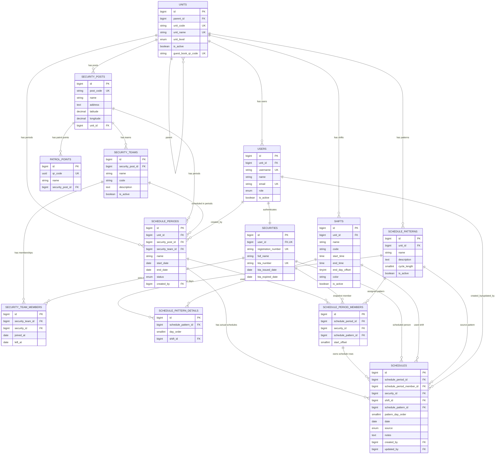

# ERD — Security Patrol Management System (Scheduling)

Diagram di bawah mencakup tabel existing yang relevan dan tabel baru Task 01.
Tidak ada perubahan schema pada Task 06–08; kolom dan relasi di bawah adalah
kondisi final modul penjadwalan.

## Catatan Relasi

- `securities` **tidak** memiliki `unit_id`/`security_post_id`.
- Unit satpam ditelusuri melalui `securities.user_id -> users.unit_id`.
- Pos satpam ditentukan melalui `security_team_members -> security_teams.security_post_id`.
- `schedule_period_members` adalah **snapshot**; tidak memiliki FK ke `security_team_members`.
- `schedules` menyimpan hasil aktual dan tidak dihitung ulang saat master pola berubah.

## Constraint Penting

- `security_teams`: unique `(security_post_id, code)` dan `(security_post_id, name)`.
- `security_team_members`: unique `(security_team_id, security_id, joined_at)`; index `(security_id, left_at)` dan `(security_team_id, left_at)`.
- `shifts`: unique `(unit_id, code)` dan `(unit_id, name)`; `start_time`/`end_time` nullable; `end_day_offset` default 0.
- `schedule_patterns`: unique `(unit_id, name)`; `cycle_length` smallint unsigned.
- `schedule_pattern_details`: unique `(schedule_pattern_id, day_order)`; FK shift restrict; FK pola cascade.
- `schedule_periods`: status enum `draft|active|completed`; index `(security_team_id, start_date, end_date)`, `(unit_id, status)`, `(security_post_id, status)`.
- `schedule_period_members`: unique `(schedule_period_id, security_id)`; `schedule_pattern_id` nullable; `start_offset` default 0.
- `schedules`: unique `(security_id, date)`; `source` enum `system_generated|adjustment`; `shift_id`, `schedule_pattern_id`, `pattern_day_order`, `notes`, dan `updated_by` nullable.

## Semantik Tanggal

- Rentang periode dan keanggotaan regu bersifat inklusif.
- `left_at = null` berarti anggota masih aktif.
- Query rentang tanggal memakai `whereDate` agar konsisten antara SQLite dan
  MySQL (SQLite dapat menyimpan `date` dengan komponen waktu `00:00:00`).

## Status Implementasi

| Task | Status |
|---|---|
| 01 Fondasi schema/model | Completed |
| 02 Master Shift | Completed |
| 03 Master Pola Rotasi | Completed |
| 04 Periode + snapshot | Completed |
| 05 Generator | Completed |
| 06 Penyesuaian manual | Completed |
| 07 Kalender & monitoring | Completed |
| 08 Final QA + dokumentasi | Completed |
| CRUD Regu/Anggota Regu | Completed (Task 09) |
