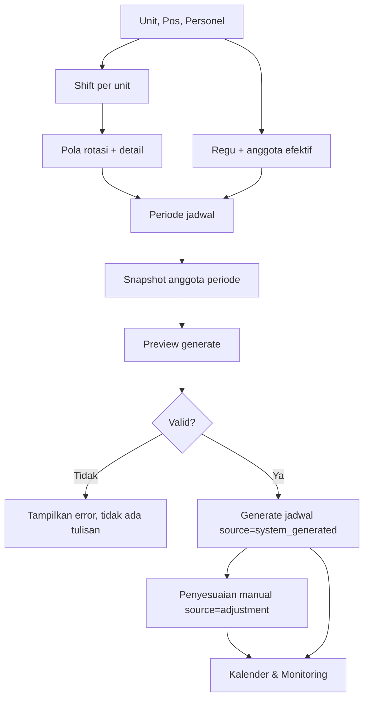

# Alur Sistem — Penjadwalan Satpam

Dokumen ini menjelaskan alur data dari master data sampai kalender monitoring,
termasuk komponen yang terlibat dan batas transaksi.

## 1. Peta Komponen

| Lapisan | Komponen | Tanggung jawab |
|---|---|---|
| Route | `routes/web.php` | Grup `auth` + prefix `admin` + middleware `role:admin,superadmin` untuk shift, pola, periode, kalender. |
| Controller | `ShiftController` | CRUD shift, toggle aktif, proteksi hapus. |
| Controller | `SchedulePatternController` | CRUD pola + detail, validasi siklus, kunci perubahan struktur. |
| Controller | `SchedulePeriodController` | CRUD periode, snapshot anggota, preview/generate, penyesuaian manual. |
| Service | `ScheduleGenerationService` | Perhitungan kandidat, preview, dan penulisan jadwal rotasi. |
| Controller | `ScheduleCalendarController` | Pembacaan jadwal aktual untuk kalender/monitoring. |
| Model | `SchedulePeriod`, `SchedulePeriodMember`, `Schedule`, `Shift`, `SchedulePattern`, `SchedulePatternDetail`, `SecurityTeam`, `SecurityTeamMember` | Relasi, validasi domain, helper snapshot/keanggotaan. |
| UI | `resources/js/Pages/Admin/Shift`, `SchedulePattern`, `SchedulePeriod`, `ScheduleCalendar` | Form master, detail periode, generate, manual adjust, kalender. |

## 2. Alur End-to-End



## 3. Alur Membuat Periode dan Snapshot

1. `POST /admin/schedule-period` divalidasi `validatePeriod()`:
   - unit dalam scope;
   - pos satu unit;
   - regu satu pos;
   - tanggal valid dan `end_date >= start_date`;
   - status valid;
   - anggota (jika ada) unik dan valid.
2. `assertNoOverlap()` menolak rentang tanggal yang overlap untuk regu yang sama
   pada semua status.
3. `resolveMembers()` menentukan snapshot:
   - `copy_from_period_id` → salin snapshot periode sebelumnya;
   - `members[]` eksplisit → pakai input;
   - tidak ada keduanya → auto-snapshot anggota regu yang aktif pada
     `start_date`.
4. Periode dan snapshot ditulis dalam satu `DB::transaction`.

Snapshot menyimpan `security_id`, `schedule_pattern_id`, dan `start_offset`.
Snapshot tidak memiliki FK ke `security_team_members`, sehingga perubahan regu
di masa depan tidak mengubah periode lama.

## 4. Alur Preview dan Generate

### 4.1 Preview

`ScheduleGenerationService::preview($period, $mode)`:

1. Memuat unit, pos, regu, anggota snapshot, pola, detail, dan shift.
2. Memvalidasi konfigurasi periode dan setiap anggota.
3. Membangun kandidat harian untuk setiap anggota.
4. Mengambil jadwal existing pada rentang tanggal (semua periode) dengan kunci
   `security_id|date`.
5. Mengklasifikasikan setiap kandidat:
   - `conflict`: sudah ada jadwal di periode lain;
   - `create`: belum ada;
   - `keep_manual`: existing `source = adjustment`;
   - `skip`: mode fill dan existing rotasi;
   - `unchanged`/`update`: mode regenerate dan metadata sama/berbeda.
6. Untuk jadwal periode ini yang tidak lagi menjadi kandidat:
   - manual → `keep_manual`;
   - rotasi pada mode regenerate → `delete`.
7. Mengembalikan ringkasan, daftar anggota, baris preview, dan error.

### 4.2 Rumus Rotasi

```
selisih_hari = tanggal_kandidat - tanggal_mulai_periode   (dalam hari)
urutan_pola  = ((start_offset + selisih_hari) % cycle_length) + 1
shift        = detail_pola[urutan_pola]
```

Urutan pola bersifat 1-based. `start_offset` adalah posisi awal pada hari
pertama periode.

### 4.3 Generate

`ScheduleGenerationService::generate($period, $mode, $actor)`:

1. Menjalankan preview.
2. Jika ada error → `ValidationException`, tidak ada tulisan.
3. Dalam `DB::transaction`:
   - `create` → insert `schedules` dengan `source = system_generated`;
   - `update` → update baris rotasi milik periode ini;
   - `delete` → hapus baris rotasi yang tidak lagi relevan (regenerate);
   - `skip`/`unchanged`/`keep_manual` → tidak menulis.

## 5. Alur Penyesuaian Manual

`PUT /admin/schedule-period/{id}/schedule/{scheduleId}`:

1. Periode harus ada dan dalam unit scope.
2. Status `completed` → ditolak.
3. Validasi `shift_id` aktif dan satu unit; `notes` wajib.
4. Dalam transaksi:
   - ambil baris dengan `lockForUpdate()` dan pastikan milik periode;
   - pastikan security adalah anggota snapshot periode;
   - tolak shift yang sama;
   - update `shift_id`, `source = adjustment`, `notes`, `updated_by`.
5. Tanggal dan security tidak berubah, sehingga unique `(security_id, date)`
   tidak terlanggar.

## 6. Alur Kalender/Monitoring

`GET /admin/schedule-calendar`:

1. Tentukan bulan (`month=YYYY-MM`, fallback bulan berjalan).
2. Tentukan scope unit dan filter (unit, pos, regu, satpam, status).
3. Query `schedules` pada rentang bulan dengan `whereDate` (inklusif).
4. Eager load security, shift, periode, unit, pos, regu, dan updater.
5. Petakan setiap baris ke format tampilan:
   - shift dan waktu;
   - `source`, `notes`, `updated_by`, `updated_at`;
   - status periode dan `can_edit`;
   - `is_off` berdasarkan nama/kode shift.
6. Kirim `rows`, `legend`, `days`, dan opsi filter ke Inertia.

Kalender tidak menghitung ulang rotasi; sumber kebenaran adalah baris
`schedules`.

## 7. Unit Scope dan Otorisasi

- `superadmin` → `null` (semua unit).
- `admin`/`security` → unit sendiri + turunan (`descendantIds()`).
- Role lain atau tanpa unit → `[]` (tidak ada akses).
- Route penjadwalan dibatasi `role:admin,superadmin`; `security` tidak dapat
  mengakses menu admin meskipun helper scope mendukungnya.
- Setiap controller memeriksa scope objek sebelum membaca/mengubah data.

## 8. Batas Transaksi dan Konkurensi

| Operasi | Transaksi | Row lock |
|---|---|---|
| Buat/ubah periode + snapshot | Ya | Tidak eksplisit pada periode; validasi overlap berbasis query. |
| Generate/regenerate | Ya | Belum ada `lockForUpdate` pada periode/rentang jadwal. |
| Penyesuaian manual | Ya | `lockForUpdate` pada baris `schedules`. |
| Pindah anggota regu | Ya | `lockForUpdate` pada keanggotaan aktif. |
| Hapus master | Ya (shift/pola) | Tidak perlu; proteksi berbasis referensi. |

Catatan: dua admin yang menjalankan generate bersamaan masih dapat saling
memengaruhi. Unique `(security_id, date)` mencegah duplikasi, tetapi salah satu
transaksi dapat gagal. Hardening konkurensi generator didokumentasikan sebagai
rekomendasi, bukan perubahan pada Task 08.

## 9. Penanganan Error

- Validasi form → `ValidationException` dengan pesan per field.
- Pelanggaran FK saat hapus → ditangkap `QueryException` dan dikembalikan
  sebagai flash `error`.
- Generate gagal → seluruh transaksi rollback; pesan error ditampilkan di
  halaman preview.
- Akses lintas unit → `abort(403)` atau data difilter keluar dari scope.
